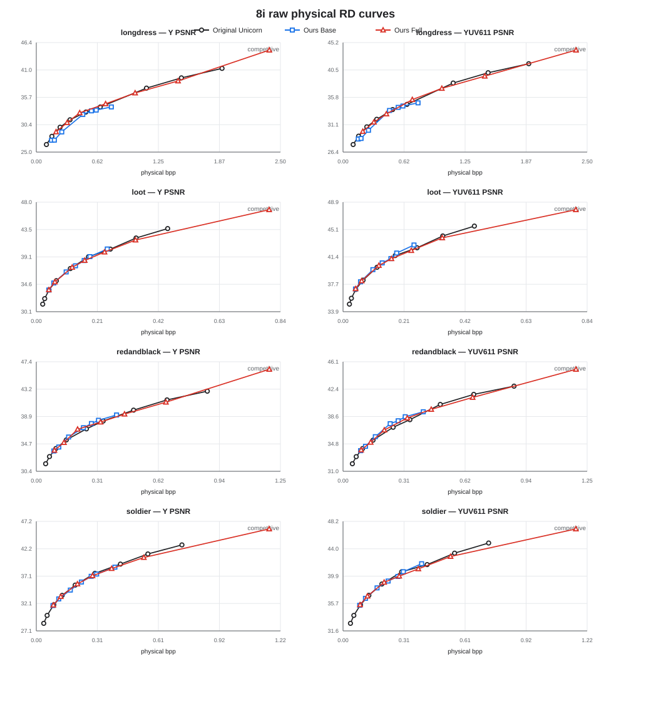

# Scalable Point Cloud Attribute Compression

This master's thesis studies **quality-scalable compression of static RGB point clouds**. A decoder first reconstructs a Base version from the Base payload, then uses an optional Enhancement payload to produce Full. Both endpoints retain the input's full spatial resolution.

The implementation extends **Unicorn Part II** with learned BaseSynthesis and conditional Enhancement decoding. Explore the [final results](#final-results), download [pretrained models](#pretrained-models), or follow the [Quick Start](#quick-start).

## OURS architecture

```text
Base payload: x_low + r1-r4
    -> Unicorn prefix + learned BaseSynthesis
    -> full-resolution Base and decoded state
    -> optional Enhancement decoding conditioned on Base
    -> full-resolution Full
```

BaseSynthesis completes the truncated Unicorn prefix without adding payload bits. Base decodes independently; Full reuses its payload and decoded state and adds the separately entropy-coded Enhancement payload. See [Method](docs/METHOD.md) for the model and training objective.

## Final results

The evaluation compares Original Unicorn, OURS Base and OURS Full on 20 samples: four 8iVFB, four Owlii and twelve CTC. BD-BR relative to Original Unicorn is:

| Dataset | Base Y | Base YUV611 | Full Y | Full YUV611 |
| --- | ---: | ---: | ---: | ---: |
| 8iVFB | +5.205% | -0.723% | +1.452% | +1.390% |
| Owlii | +10.110% | +4.992% | +1.855% | +2.077% |
| CTC | +1.848% | -0.326% | +0.155% | -0.696% |

Negative BD-BR indicates bitrate savings at equivalent quality; positive values indicate an increase. Y measures luminance quality; YUV611 combines Y/U/V PSNR with weights 6:1:1.

These results quantify the rate-distortion trade-off of the scalable endpoints. Base Y incurs a bitrate increase of 1.848–10.110% across dataset means; Full YUV611 ranges from 0.696% savings to a 2.077% increase.



[All final results](results/final/README.md) include 460 measured endpoint rows, per-sample comparisons, BD-BR tables, all three datasets' RD figures and hardware-labeled runtime data. The [evaluation protocol](docs/EVALUATION.md) defines physical rates, preprocessing, metrics and Pareto/PCHIP interpolation.

## Quick Start

Clone the repository and enter its root directory:

```bash
git clone https://github.com/whitesocksjames/scalableattributethesis.git
cd scalableattributethesis
```

Follow [INSTALL.md](docs/INSTALL.md) to configure a Linux environment and activate it before continuing. The validated runtime uses **Python 3.8.20, PyTorch 1.13.1+cu117, CUDA runtime 11.7 and MinkowskiEngine 0.5.4**; [environment.json](configs/environment.json) records the remaining versions. A completely fresh dependency installation and MinkowskiEngine rebuild remain unverified.

Download the **8k** model and run the bundled 512-point synthetic example. The downloader checks both file size and SHA-256:

```bash
python -m scalable_attribute.download --point 8k --output checkpoints
python -m scalable_attribute.evaluate \
  --checkpoint checkpoints/ours_8k.pth \
  --input examples/example.ply --output outputs/example \
  --gpcc third_party/tmc3_v21 --pc-error third_party/pc_error_d
cat outputs/example/rates.json
```

The command writes `base.ply`, `full.ply`, payload files and `rates.json` under `outputs/example/`. The report contains physical bits, bits per point, Base/Full quality metrics, and these successful encode/decode checks:

```json
{
  "base_encode_decode_exact": true,
  "full_encode_decode_exact": true
}
```

Choose a new `--output` directory for each run. Add `--endpoint base` to run Base alone. Encode and decode on the same backend: CPU and GPU outputs are not bit-exact interchangeable. The example checks the codec interface; the thesis measurements use the benchmark protocol linked above.

## Pretrained models

The seven operating points are **512 / 1k / 2k / 4k / 8k / 16k / 32k**. Their names identify the model's nominal rate-distortion weight λ: for example, `1k = 1024` and `8k = 8192`. All seven support Base and Full at the input's spatial resolution. Start with 8k for the Quick Test.

Each approximately 136 MB checkpoint contains the complete Prefix, BaseSynthesis and Enhancement state, so inference loads one file per operating point. No additional Original Unicorn weight file is needed. The [GitHub Release](https://github.com/whitesocksjames/scalableattributethesis/releases/tag/thesis-handover-v1) hosts all seven models, totaling 952,005,347 bytes, with a [manifest](configs/checkpoints.json) and [SHA-256 list](configs/SHA256SUMS).

To download and independently verify all seven:

```bash
python -m scalable_attribute.download --point all --output checkpoints
(cd checkpoints && sha256sum -c ../configs/SHA256SUMS)
```

## Repository structure

| Path | Contents |
| --- | --- |
| `scalable_attribute/models/` | Prefix, BaseSynthesis and Enhancement composition |
| `scalable_attribute/runtime/` | Checkpoint loading and Base/Full encode/decode |
| `scalable_attribute/download.py`, `scalable_attribute/evaluate.py` | Verified model download and evaluation entry points |
| `basic_models/`, `lossy_attribute/`, `data_utils/`, `cfg/` | Required network, entropy, I/O and fixed configuration dependencies |
| `results/final/` | Raw RD data, BD-BR tables, figures and runtime results |
| `configs/`, `examples/` | Environment, model/sample identities and the synthetic Quick Test input |
| `scripts/scalable_attribute/` | CTC preprocessing/aggregation and result analysis |
| `tests/`, `docs/`, `third_party/` | Regression checks, method/protocol, codec tools and attribution |

## Evaluation and result analysis

Recompute the BD-BR tables and redraw the RD figures using only the Python standard library:

```bash
python scripts/scalable_attribute/analysis/recompute_pareto_bdbr.py \
  --raw results/final/evidence/raw_rd_points.csv --output outputs/bdbr
python scripts/scalable_attribute/analysis/plot_final_static_rgb_rd.py \
  --raw results/final/evidence/raw_rd_points.csv --output-dir outputs/rd-figures
(cd results/final && sha256sum -c SHA256SUMS)
```

For benchmark inputs and CTC chunk evaluation, follow [Evaluation](docs/EVALUATION.md#running-evaluation). Datasets are obtained separately. Physical attribute rates exclude geometry support and serialized-container overhead, as specified in the protocol.

For regression checks, install `requirements-test.txt` and run `python -m pytest -q`. Codec-dependent tests require the declared runtime.

## Reference and attribution

This work builds on [NJUVISION/Unicorn](https://github.com/NJUVISION/Unicorn/tree/b50d6c1bd033185b9e893b755d5d316cca2d4448) and *A Versatile Point Cloud Compressor Using Universal Multiscale Conditional Coding — Part II: Attribute Compression* ([paper](https://ieeexplore.ieee.org/document/10682566)). OURS adds learned full-resolution BaseSynthesis and the conditional Enhancement endpoint. [THIRD_PARTY.md](THIRD_PARTY.md) records attribution, tool notices and the unresolved upstream redistribution status.
